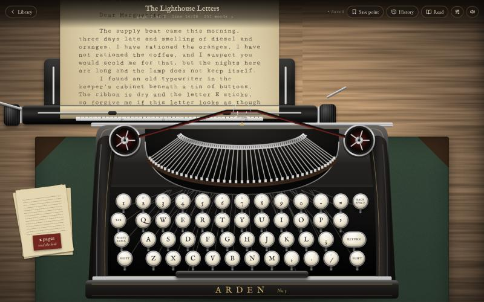
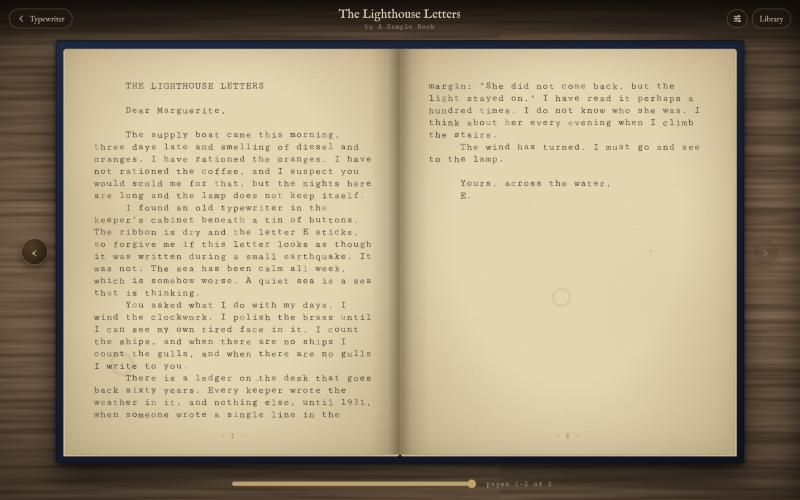

# Inkwell

Inkwell is an old typewriter in your browser, made for writing whole books. You type on a vintage machine, the paper
moves with every keystroke, and when a page is full it gets pulled out and bound into your book. Later you can sit back
and flip through what you wrote like a real book.

**Try it here: [inkwell-typewriter.vercel.app](https://inkwell-typewriter.vercel.app)**





## Why I made it

Writing in a normal text editor is easy to fiddle with forever. A typewriter pushes you forward: one line, then the
next, then the next page. Inkwell keeps that feeling (the clack, the bell near the margin, the carriage return) but
still lets you fix a typo without correction fluid.

## What you can do

**Write on a real-feeling typewriter**
- Type with your keyboard, or click the keys on screen.
- Each key press swings a typebar up to the paper, lifts the ribbon and moves the carriage along.
- A bell rings near the end of the line. If a word runs past the margin, it moves down to the next line for you.
- Pressing Enter (or clicking the lever on the left) slides the carriage back and feeds the paper up a line.

**Fill pages and bind them into a book**
- A sheet holds 28 lines of 44 characters. When it's full, it's pulled out and a fresh one rolls in.
- Click **Read** to see your book open on the desk, with pages that turn in 3D.

**Fix mistakes**
- Click any letter on the page, scroll over the paper, or use the arrow keys to bring the carriage there.
- New letters are slipped in (Insert mode), or typed on top of the old ones (Strike over mode, toggled with the Insert key).
- Page Up and Page Down swap earlier sheets back into the machine.
- When you're done, press ⌘/Ctrl ↓ or click "back to where you left off".

**Keep several books**
- The library is a shelf of leather-bound books. Each one has its own title, author, cover colour and paper.
- You can export any book as a plain `.txt` file.

**Make it yours**

Open the sliders icon in the top bar to change:
- The room: Lamplit study, Morning light, Midnight, Candlelight or Café marble.
- The typewriter colour and the ink colour.
- How the keys sound: Classic manual, Heavy office, Portable, Electric, Muffled, or silent.
- The ambience: rain on a window, a fireplace, the sea, sunrise, sunset over golden fields, snowfall, a summer night
  or a ticking clock.
  You hear it and, behind the typewriter, you see it: real footage of the place, with your table in front.
  It can also be set to a subtle tint or to sound only.
- Focus mode, which hides everything except the machine and the page.

All of the sounds are generated in the browser, so there are no audio files.

## Keyboard shortcuts

| Key | What it does |
| --- | --- |
| Enter | Carriage return |
| Backspace / Delete | Erase a letter |
| Tab | Jump to the next tab stop |
| Arrow keys, Home, End | Move the carriage around the page |
| Page Up / Page Down | Previous / next sheet |
| ⌘/Ctrl ↓ | Back to where you left off |
| Insert | Switch between Insert and Strike over |
| ⌘/Ctrl S | Make a save point |
| ⌘/Ctrl . | Focus mode on or off |
| ← / → (while reading) | Turn the page |

## Will I lose my writing?

Not if you keep a couple of things in mind. Inkwell has no accounts and no server. Your books live in your own browser,
on your own computer, and nothing you write is sent anywhere.

What Inkwell does for you:
- **It saves as you type.** About half a second after each keystroke, and straight away if you close or switch away
  from the tab. The dot next to "Saved" in the top bar turns gold while a save is on its way.
- **It asks the browser to keep its storage**, so the browser is less likely to clear it when space runs low.
- **It protects you from two tabs fighting.** If you open the same book in a second tab, the first tab stops typing
  into it and offers to take it back. Changes to different books in different tabs are all kept.
- **Save points** (⌘/Ctrl S or the bookmark button) take a snapshot of the book. **History** lets you go back to any of
  them. Restoring also keeps your current version as a save point, so you can't lose it that way either.

What you should do:
- **Click "Back up library" now and then.** It's on the shelf screen and downloads one small file with all your books
  and save points. "Restore backup" brings them back, in any browser, on any computer. The shelf reminds you if it's
  been more than a week.
- **Use the same browser each time.** Chrome and Safari keep separate storage, and so do private or incognito windows,
  which forget everything when you close them.
- **Don't clear your browser's site data** for Inkwell, or your books go with it.
- **On Safari (Mac, iPhone, iPad):** Safari can delete website storage if you haven't visited the site for about a week.
  If you write on Safari, keep a recent backup. You can also add Inkwell to your Home Screen or Dock, which helps.

## Running it yourself

There is no build step and nothing to install. It's plain HTML, CSS and JavaScript.

```bash
git clone https://github.com/j0hndoescode/inkwell.git
cd inkwell
python3 -m http.server 8642
```

Then open http://localhost:8642. Opening `index.html` directly also works, but the browser treats that as a different
place from `localhost`, so each one has its own library.

### Deploying

It's a static site, so any static host works. On Vercel: import the repository, leave the framework preset as
"Other", and deploy. No build command or output directory is needed.

## How it's put together

| File | What's in it |
| --- | --- |
| `index.html` | The three screens (shelf, desk, reader), dialogs and the settings drawer |
| `css/style.css` | Everything visual: paper, leather, wood, room themes, the drawer |
| `js/config.js` | Page size, machine size, bindings, papers, finishes, themes, inks and sound lists |
| `js/machine.js` | Draws the typewriter and animates the keys, typebars, ribbon and carriage |
| `js/sheet.js` | Renders aged paper with slightly uneven, inky type |
| `js/reader.js` | The open book and its page turns |
| `js/sound.js` | The synthesised typewriter voices and background sounds |
| `js/fx.js` | The ambience in the room: footage, the table, soft edges, and the faint "subtle" look |
| `js/scenes.js` | Painted versions of each place, used when the footage isn't available |
| `media/` | The background footage (about 14 MB) and a still frame for each |
| `js/store.js` | Saving to the browser, merging between tabs, persistent storage |
| `js/app.js` | Ties it together: the shelf, typing and editing, save points and settings |

The background footage comes from [Mixkit](https://mixkit.co) under its free stock video licence: [waves on the
beach](https://mixkit.co/free-stock-video/waves-coming-to-the-beach-5016/), [a rainy window](https://mixkit.co/free-stock-video/window-on-a-rainy-day-2846/),
[a fireplace](https://mixkit.co/free-stock-video/closeup-view-of-a-fireplace-2709/), [a mountain from night to dawn](https://mixkit.co/free-stock-video/mountain-during-the-night-until-dawn-4357/),
[sunset over fields of tall grass](https://mixkit.co/free-stock-video/sunset-over-fields-of-tall-dry-grass-2639/),
[snowy pine branches](https://mixkit.co/free-stock-video/pine-branches-in-winter-3311/), [the Milky Way](https://mixkit.co/free-stock-video/milky-way-seen-at-night-4148/)
and [library shelves](https://mixkit.co/free-stock-video/bookcase-of-a-library-seen-in-detail-21586/). The clips were shortened,
colour-graded where needed, compressed and turned into seamless loops. If they can't load, Inkwell paints a version of each place in code instead.

Fonts are Cutive Mono, IM Fell English and EB Garamond from Google Fonts. Everything else (the wood, leather and paper
textures, and the typewriter itself) is drawn in code.
